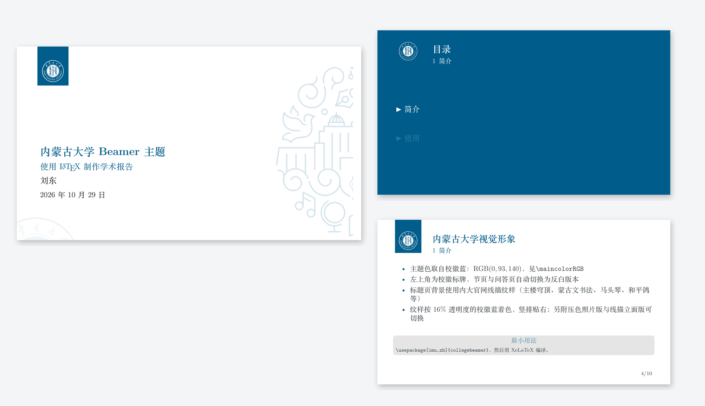

# 内蒙古大学 Beamer 主题



基于 [college-beamer](https://github.com/liu-qilong/college-beamer) 排版框架的
内蒙古大学（Inner Mongolia University）Beamer 主题，新增 `imu` 选项。
16:9 幻灯片，中文用 XeLaTeX 编译。

A beamer theme for Inner Mongolia University, built on top of college-beamer.

## 快速开始

方式一：直接用本仓库（已包含打好补丁的 `collegebeamer.sty`）

```bash
git clone https://github.com/liudong1999/imu-beamer.git
cd imu-beamer && latexmk -xelatex pre-imu.tex
```

方式二：合入上游 college-beamer 仓库

```bash
git apply upstream.patch
mkdir -p src/IMU gallery
cp -r /path/to/imu-beamer/src/IMU/*.png src/IMU/
cp /path/to/imu-beamer/gallery/IMU.png gallery/
```

然后在导言区写：

```latex
\documentclass{beamer}
\usepackage[imu,zh]{collegebeamer}
```

## 设计

- **主色 校徽蓝 RGB(0, 93, 140)**：直接取自校徽文件里唯一的非透明颜色，
  因此主题色与校徽完全一致（不是凭视觉挑的近似值）。
- **左上角标牌**：浅色页用蓝底反白校徽（`color-logo.png`）；
  章节页与 Q&A 页自动换成透明底反白版（`trans-logo.png`），沿用上游 `\themecolor` 机制。
- **标题页背景**（`background.png`）：内大官网的**线描纹样条**（主楼穹顶、蒙古文书法、
  马头琴、和平鸽、毕业帽、蒙古文古籍等元素），按 16% 透明度的校徽蓝着色，竖排贴右；
  左下角另留一枚裁切校徽弧线作点缀。
- 同一份素材还生成了两个备选背景，改 `collegebeamer.sty` 里 `\backgroundPath` 即可切换：
  `background-photo.png`（主楼照片压色版：校徽蓝 duotone + 左侧白渐变）、
  `background-lines.png`（主楼抽象线描立面：轮廓 + 穹顶等高线 + 楼板线 + 校徽圆）。
- 版式（16:9、页脚页码、块样式、目录页高亮）完全复用上游，未改动任何公共布局代码。

## 目录结构

```text
collegebeamer.sty        上游排版框架 + imu 选项（已打补丁，可直接用）
pre-imu.tex              中文示例：标题页、目录、代码块、表格分栏、数学、Q&A 页
pre-imu.pdf              上面示例的编译结果（10 页）
src/IMU/
  color-logo.png         906 x 1134 蓝底反白校徽（浅色页用）
  trans-logo.png         906 x 1134 透明底反白校徽（深色页用）
  background.png         2560 x 1440 标题页背景（官网线描纹样版，约 130 KB）
  background-photo.png   2560 x 1440 备选：主楼照片压色版（约 590 KB）
  background-lines.png   2560 x 1440 备选：主楼抽象线描立面（约 68 KB）
gallery/IMU.png          预览图，可直接放进上游 gallery/
upstream.patch           相对上游的全部改动（sty + README 表格 + pre.tex 选项注释）
tools/build_assets.py    由 tools/source/ 重新生成 src/IMU/ 的全部背景与标牌
tools/make_gallery.py    由编译好的 PDF 合成 gallery/IMU.png
tools/source/            原始素材（校徽、官网线描纹样、主楼照片）
```

## 编译

```bash
latexmk -xelatex pre-imu.tex      # 中文必须用 XeLaTeX
```

依赖：TeX Live 2025 及以上（含 `animate`、`ifplatform`、`xeCJK`）；
重新生成素材需要 Python 3 + Pillow + numpy + scipy + PyMuPDF。

## 重新生成素材

```bash
python3 tools/build_assets.py    # 重写 src/IMU/*.png
python3 tools/make_gallery.py    # 由 pre-imu.pdf 重做 gallery/IMU.png
```

`tools/source/emblem.png` 是 1024 x 1024 的透明底校徽（单色），
`tools/source/lineart.png` 是官网的线描纹样条，`tools/source/main-building.jpg` 是主楼照片。
脚本末尾三段分别生成线描立面版、照片压色版、官网纹样版背景（默认 `background.png` 是后者）。
可调参数：纹样版 `ALPHA`（着色浓度）；照片版 `KEY`、`FADE0`、`FADE1`；
线描立面版 `LINE_W`、`LINE_ALPHA`、楼板线条数与穹顶等高线圈数。

## 许可与致谢

- 排版框架、样式代码来自 [liu-qilong/college-beamer](https://github.com/liu-qilong/college-beamer)，
  采用 [CC BY 4.0](LICENSE.md) 许可；本仓库在此基础上新增 `imu` 选项与素材。
- 校徽、校名书法、线描纹样与主楼照片是内蒙古大学的机构标识与校园影像，版权归学校所有；
  本仓库按上游惯例仅在演示模板中使用，不构成授权。
- 想把这个主题合回上游，见 `upstream.patch`（README 表格里的贡献者占位符请替换成你的 GitHub 账号）。
